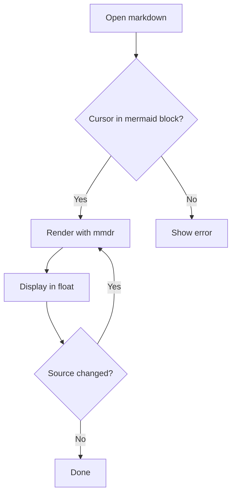
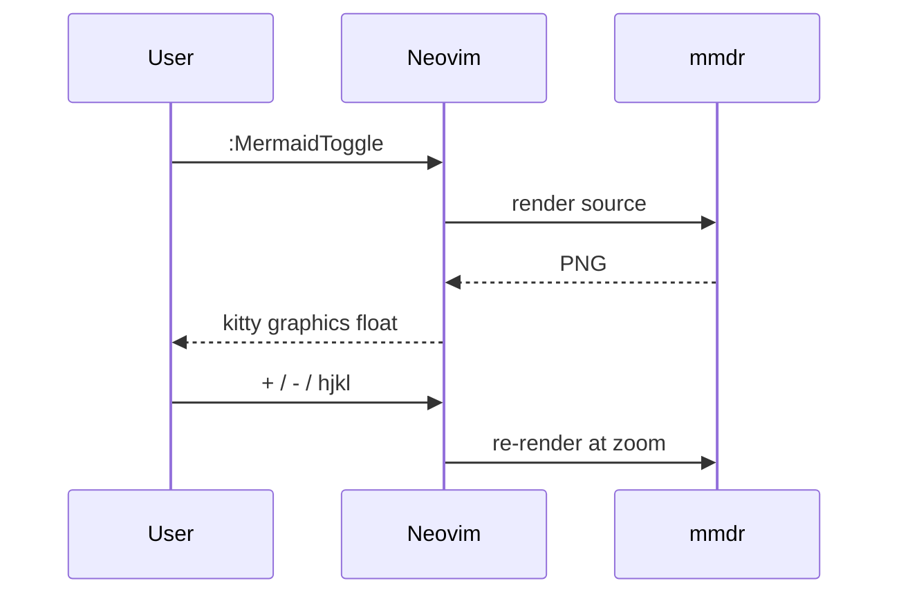
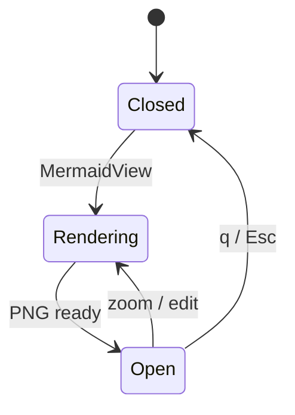
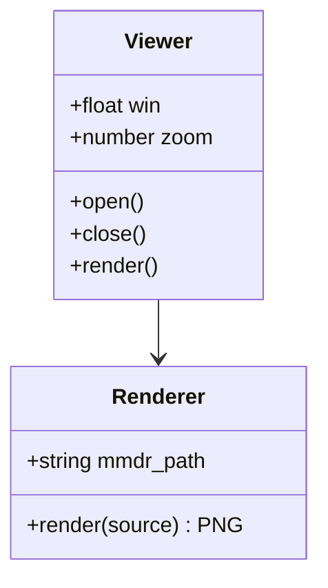
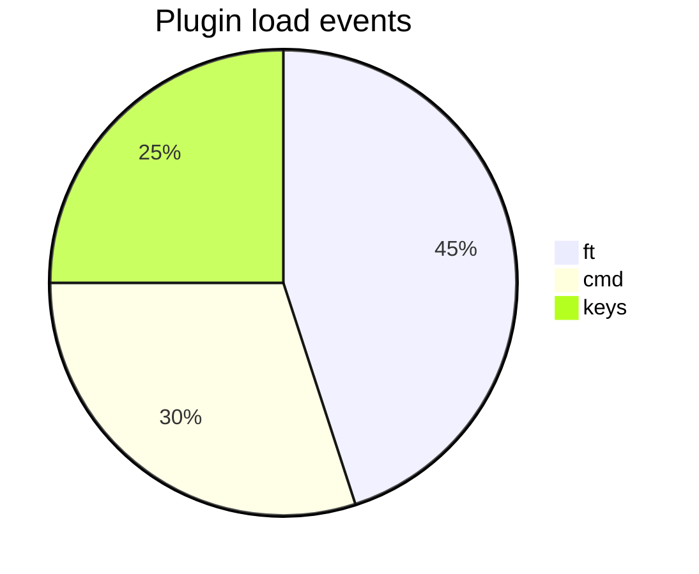

# Mermaid viewer test

Put the cursor inside a block and press `<leader>um`.

## Flowchart



## Sequence



## State



## Class



## Pie



## Not mermaid (viewer should not pick this up)

```lua
print('hello')
```

## Broken diagram (error handling)

```mermaid
flowchart TD
    A -->
    --> B
```
